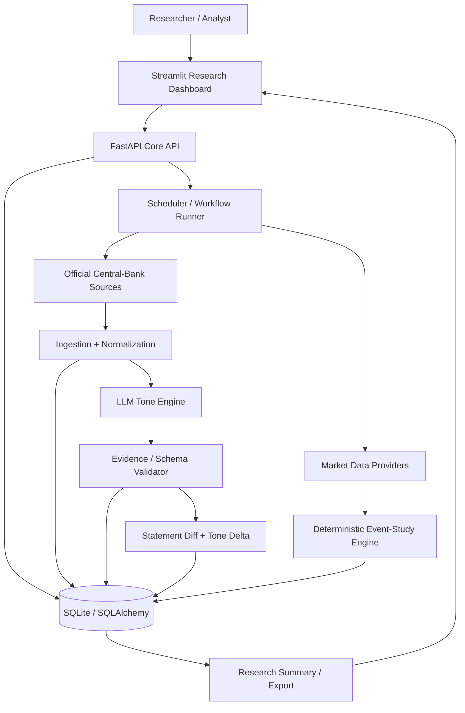
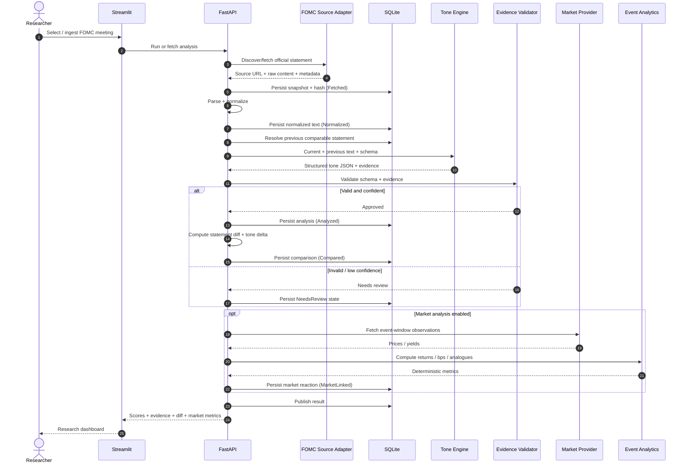
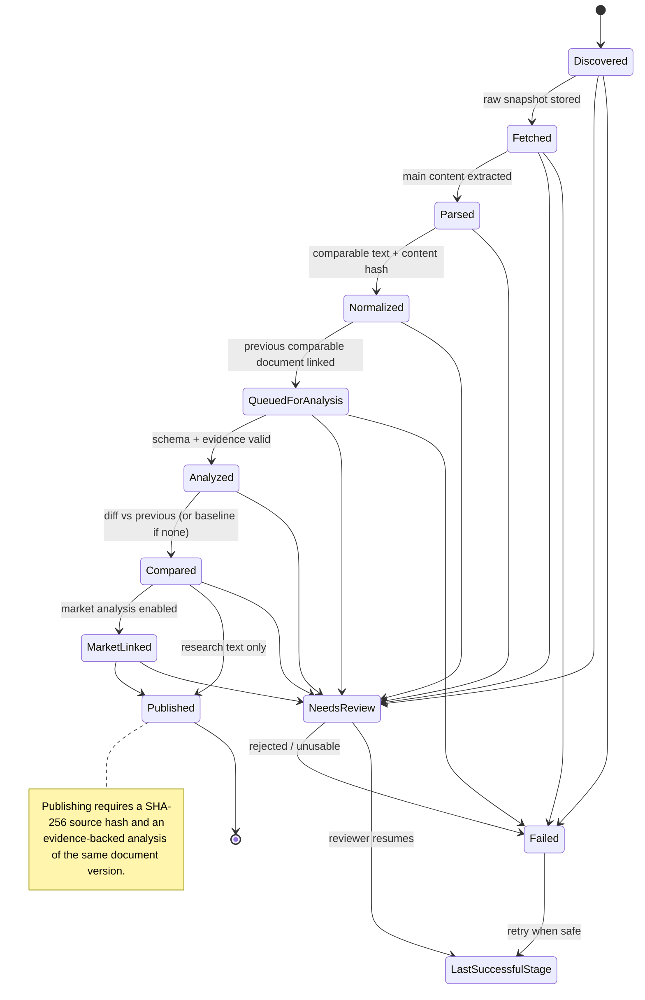
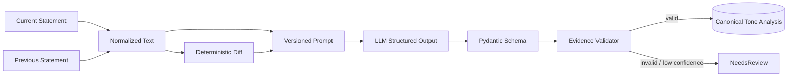
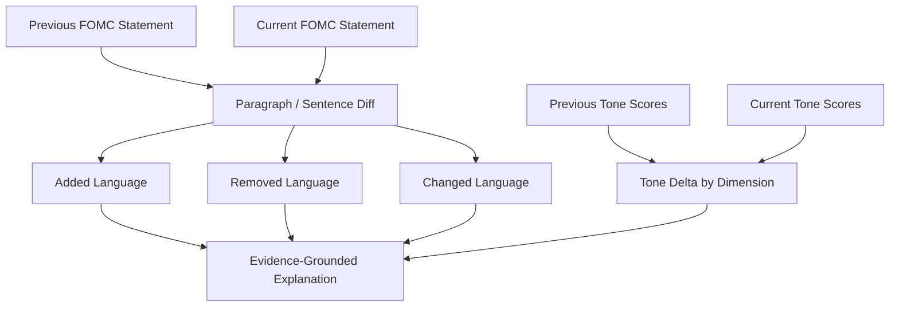
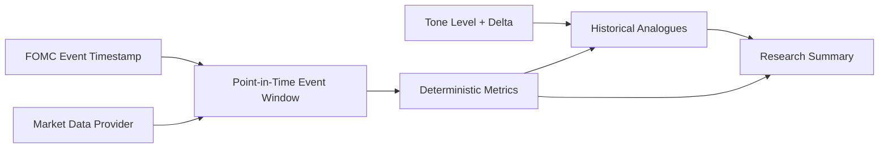
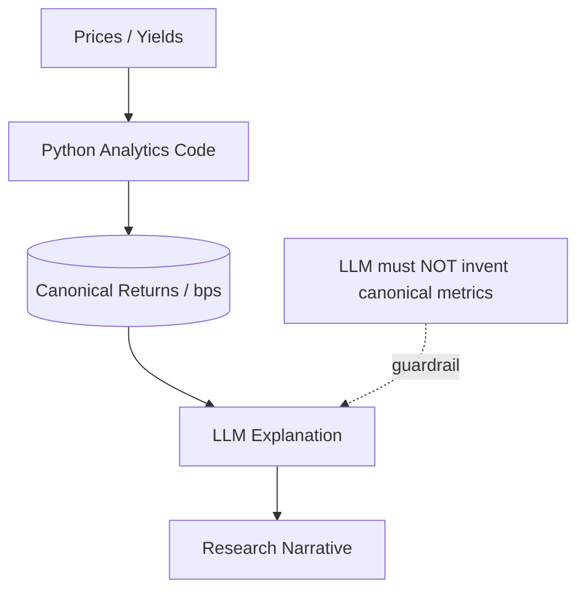
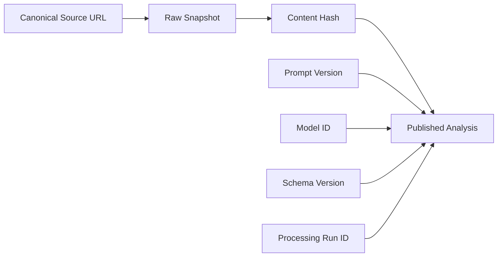
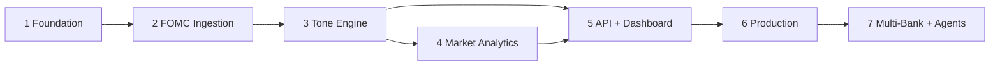

# FedTone Diagrams

Mermaid diagrams for the FedTone architecture, processing workflow, state machine and research-integrity boundaries.

**Related documents:** [ARCHITECTURE.md](./ARCHITECTURE.md) · [ROADMAP.md](./ROADMAP.md) · [PHASES.md](./PHASES.md)

---

## 1. System Architecture (C4-Style Flowchart)



---

## 2. End-to-End FOMC Research Lifecycle (Sequence)



---

## 3. Policy Document State Machine (FSM)



Every non-terminal stage may move to `NeedsReview` or `Failed` (only some arrows are drawn).
`LastSuccessfulStage` stands for the stage recorded in `last_successful_status`: a document
resumes exactly there, so the pipeline re-attempts the step that broke. `Published` is
terminal; reprocessing creates new versions instead. Enforced by
`fedtone.domain.models.transition()` (Task 1.3).

### State Reference

| State | Role |
|---|---|
| `Discovered` | Official source item found. |
| `Fetched` | Raw source retrieved and fingerprinted. |
| `Parsed` | Main text extracted. |
| `Normalized` | Comparable policy text available. |
| `QueuedForAnalysis` | Waiting for LLM analysis. |
| `Analyzed` | Valid structured tone output persisted. |
| `Compared` | Previous-document diff and tone delta available. |
| `MarketLinked` | Deterministic event metrics attached. |
| `NeedsReview` | Confidence/evidence/parser issue requires inspection. |
| `Published` | Visible to API/UI. |
| `Failed` | Processing stopped with auditable error. |

---

## 4. Tone Analysis Flow



### Score Convention

```text
-1.00                  0.00                  +1.00
Strongly Dovish ------- Neutral ------- Strongly Hawkish
```

Dimensions:

```text
Overall
├── Inflation
├── Labor
├── Growth
├── Policy Guidance
└── Balance Sheet
```

---

## 5. Statement Comparison Flow



---

## 6. Market Reaction Research Flow



### Numeric Boundary



---

## 7. Research Integrity & Reproducibility Chain



### Operational Guarantees

1. **No score without provenance:** every published analysis resolves to an official source and content hash.
2. **No unsupported evidence:** evidence strings are validated against source text.
3. **No LLM finance arithmetic:** canonical returns/yield changes come from deterministic functions.
4. **No look-ahead:** historical analogue/event-study queries enforce event-time cutoffs.
5. **No silent model migration:** model/prompt/schema versions remain attached to every analysis.
6. **No duplicate canonical documents:** ingestion uses stable identity/hash checks.

---

## 8. Phase Dependency Diagram



---

## Diagram Maintenance

- Keep diagrams aligned with `ARCHITECTURE.md` and `PHASES.md`.
- When lifecycle states change, update the FSM and state reference together.
- When a new provider/agent is introduced, show whether it owns canonical data or only interpretation.
- Prefer Mermaid source in-repo over binary diagrams for reviewability.
